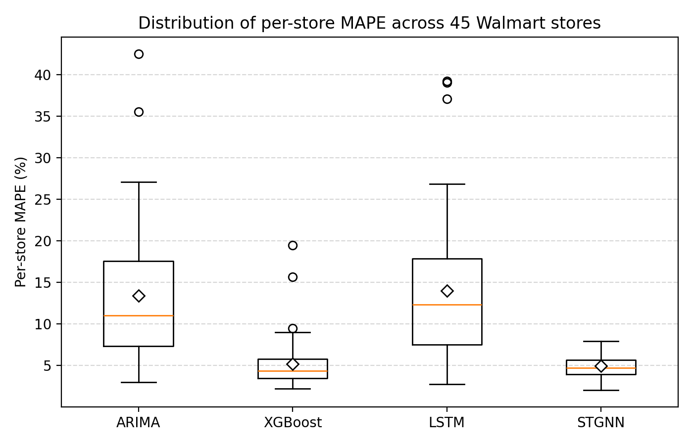
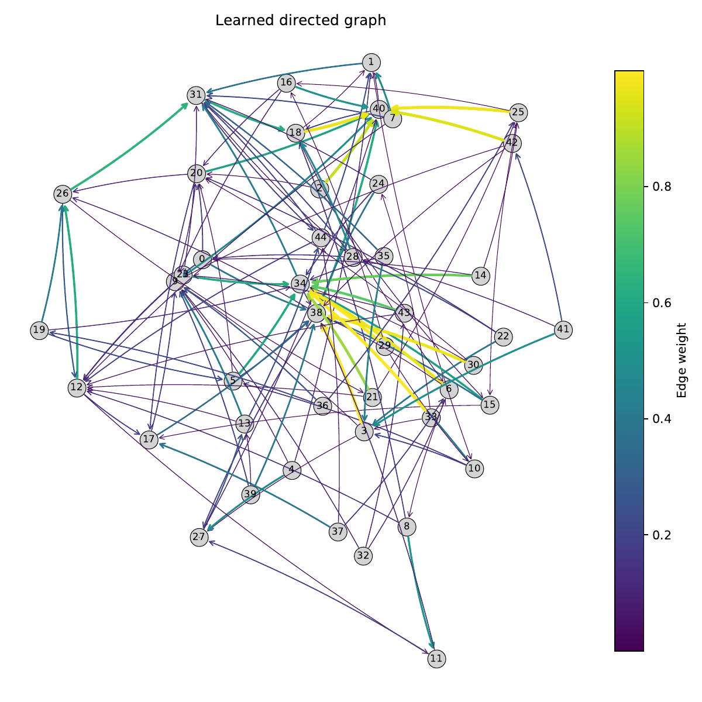

# Spatiotemporal Graph Neural Networks for Multi-Store Sales Forecasting

[](https://arxiv.org/abs/2511.19267)


[](LICENSE)

Code, results and analysis for the preprint
**"Leveraging Spatial-Temporal Graph Neural Networks for Multi-Store Sales Forecasting"**
(Manish and Arpita Dayama, IIT Bombay; [arXiv:2511.19267](https://arxiv.org/abs/2511.19267)).

Retail stores do not sell in isolation: regional demand, shared promotions and
macroeconomic shocks make their sales series move together. This project asks
whether modelling those **inter-store dependencies** improves weekly sales
forecasts. We propose a spatiotemporal graph neural network (STGNN) that
**learns a directed store-to-store graph directly from data**, with no
geographic metadata, and combine it with dilated temporal convolutions. On
45 Walmart stores it is compared against per-store ARIMA, XGBoost and LSTM
baselines.

---

## Key results

Aggregate metrics over all **45 stores** on the chronological hold-out period
(lower is better, except Win Rate):

| Model | NTAE (%) ↓ | Win Rate vs. persistence (%) ↑ | P90 MAPE (%) ↓ | Var. of MAPE ↓ |
|---|---:|---:|---:|---:|
| **STGNN (ours)** | **4.93** | **49.02** | **6.98** | **1.75** |
| XGBoost | 4.99 | 48.17 | 7.30 | 9.79 |
| LSTM | 12.95 | 18.11 | 21.75 | 72.38 |
| ARIMA(1,0,1)+X | 13.36 | 22.06 | 24.09 | 70.85 |

- **Most accurate and most consistent:** STGNN has the lowest pooled error
  (NTAE), the best worst-decile error (P90 MAPE) and a **~5.6× lower spread** of
  per-store MAPE than XGBoost.
- **Best single store:** Store 37 reaches **2.08 % MAPE** (MAE $10.9k), roughly
  half of ARIMA's error on the same store (3.98 %).
- **XGBoost remains a strong baseline**, particularly for stores weakly
  connected to the rest of the network; LSTM tends to over-smooth volatile
  stores given only ~140 weeks per store.

<p align="center">
  
</p>

> The P90 and variance columns can be re-derived from the saved per-store
> results with `python src/plot_model_comparison.py`
> (→ `results/metrics/aggregate_metrics.csv`).

---

## Methodology

### 1. Data

[Walmart weekly sales](https://www.kaggle.com/datasets/yasserh/walmart-dataset)
(Kaggle): **45 stores**, weekly from **Feb 2010 to Oct 2012** (143 weeks per
store, 6,435 rows). Each record contains `Weekly_Sales` (USD), a holiday flag,
`Temperature`, `Fuel_Price`, `CPI` and `Unemployment`.

### 2. Feature engineering (`src/features.py`)

| Group | Features |
|---|---|
| Calendar | year, month, ISO week, day-of-week; sine/cosine encodings of week-of-year and month |
| Holidays | `is_major_holiday` (Thanksgiving, Christmas), `is_minor_holiday` (other flagged holiday weeks) |
| Lags | weekly sales lagged by 1, 2, 3, 7, 14, 28, 52 weeks (per store) |
| Rolling statistics | means over 3, 4, 8, 12, 52 weeks; std. devs over 3, 4, 8, 52 weeks |
| Smoothing | EWMA with spans 3, 7, 14 |
| Target | `sales_log1p = log(1 + Weekly_Sales)` |

All rolling and EWMA features are **shifted by one week** so that only past
information enters the inputs. Missing values from the warm-up period are
forward/back-filled **within each store**, then zero-filled.

### 3. Proposed model: STGNN (`notebooks/04_stgnn.ipynb`)

**Stationary target.** Sales are arranged as a matrix
$Y \in \mathbb{R}^{T \times S}$ ($S = 45$ stores). The model predicts the
weekly log-difference

$$\Delta_{t,s} = \log(1 + Y_{t,s}) - \log(1 + Y_{t-1,s}),$$

and the forecast is reconstructed as
$\hat{Y}_{t,s} = \exp\big(\log(1+Y_{t-1,s}) + \hat{\Delta}_{t,s}\big) - 1$.
Exogenous features $X \in \mathbb{R}^{T \times S \times F}$ are standardised
and fed as sliding windows of **12 weeks**.

**Architecture.**

```
 input window (B, F, S, 12)
        │
   1×1 conv  ─────────────────────────────┐  (residual)
        │                                 │
 dilated TCN: 1×3 conv (d=1) → GELU → 1×3 conv (d=2)
        │                                 │
 graph conv  Z = Â · H · W   ◄── GraphLearner Â
        │                                 │
        └──────────────── + ◄─────────────┘
        │
 last time step → 1×1 conv → Δ̂ for every store (B, 1, S, 1)
```

1. **Adaptive graph learner.** Two learnable node-embedding tables
   $E_1, E_2 \in \mathbb{R}^{S \times 40}$ (each followed by a linear layer)
   define a dense, *directed*, row-normalised adjacency

   $$\hat{A} = \mathrm{softmax}\big(\mathrm{ReLU}(E_1 E_2^{\top})\big).$$

   $\hat{A}_{ij}$ can be read as how much store $i$ attends to store $j$.
2. **Temporal block.** Stacked 1×3 convolutions with dilations 1 and 2 give a
   multi-scale receptive field over each store's history.
3. **Spatial block.** A graph convolution $Z = \hat{A} H W$ propagates
   information between related stores; a residual connection preserves the
   store's own temporal signal.
4. **Output.** A 1×1 convolution on the final time step predicts next-week
   $\hat{\Delta}$ for all 45 stores jointly.

**Training.** Smooth-L1 (Huber) loss, AdamW (lr $10^{-3}$, weight decay
$10^{-4}$), batch size 32, `ReduceLROnPlateau` (factor 0.5, patience 5),
chronological 80 / 20 split of the windows. Trained weights are in
`checkpoints/`.

### 4. Baselines

| Model | Setup | Notebook |
|---|---|---|
| ARIMA | One ARIMA(1,0,1) per store on `log1p` sales with all engineered features as exogenous regressors; fixed order for cross-store comparability; 80 / 20 chronological split | `01_arima.ipynb` |
| XGBoost | One regressor per store on `log1p` sales; 1000 trees, learning rate 0.05, max depth 6, subsampling; 80 / 20 chronological split | `02_xgboost.ipynb` |
| LSTM | One model per store; sequence length 10; LSTM(128) → LSTM(64) with dropout 0.3 / 0.2 and dense head; Huber loss, Adam; 70 / 15 / 15 chronological split | `03_lstm.ipynb` |

### 5. Evaluation metrics

For actual sales $y_{s,t}$ and forecasts $\hat{y}_{s,t}$ over stores $s$ and
test weeks $t$:

| Metric | Definition | What it captures |
|---|---|---|
| MAE, RMSE, MAPE | Standard per-store errors (USD / %) | Store-level accuracy |
| **NTAE** | $\dfrac{\sum_{s,t} \lvert y_{s,t} - \hat{y}_{s,t} \rvert}{\sum_{s,t} y_{s,t}} \times 100$ | Network-wide error, weighted by sales volume |
| **P90 MAPE** | 90th percentile of per-store MAPE | Worst-decile (tail) performance |
| **Var. of MAPE** | Variance of per-store MAPE | Consistency across stores |
| **Win Rate** | Share of $(s,t)$ points where the model beats a persistence forecast $\hat{y}_{s,t} = y_{s,t-1}$ | Value over the naïve baseline |

---

## Learned store graph

<p align="center">
  
</p>

The learned adjacency (top-3 outgoing edges per store shown above; nodes are
0-indexed) reveals structure that was never given to the model:

- **Communities.** Re-ordering $\hat{A}$ by hierarchical clustering exposes
  block-diagonal groups of stores with similar sales dynamics.
- **Hub stores.** By mean outgoing attention, stores **39, 29, 18, 19, 28** are
  the most central and **38, 27, 4, 21, 35** the least
  (`results/graph/store_centrality_metrics.csv`).
- **Centrality ≠ predictability.** Stores 29 and 28 are hubs yet among the
  hardest to forecast for both STGNN and XGBoost: their series are noisy and
  weakly seasonal. Centrality measures influence on *other* stores, not local
  forecastability.
- **Isolated stores** gain little from relational modelling, which is where
  XGBoost is most competitive.

Interactive 2-D and 3-D versions of the graph are in `results/graph/`
(open the `.html` files in a browser).

---

## Repository structure

```
sales-demand-forecasting/
├── data/
│   ├── raw/Walmart.csv               # original Kaggle dataset
│   └── processed/features.csv        # output of src/features.py
├── src/
│   ├── features.py                   # feature-engineering pipeline
│   ├── eda_summary.py                # summary tables and EDA figures
│   ├── store_clustering.py           # DBSCAN store-profile clustering (PCA / t-SNE)
│   └── plot_model_comparison.py      # aggregate metrics + MAPE distribution plot
├── notebooks/
│   ├── 01_arima.ipynb
│   ├── 02_xgboost.ipynb
│   ├── 03_lstm.ipynb
│   ├── 04_stgnn.ipynb                # proposed model, graph analysis
│   └── 05_model_comparison.ipynb
├── results/
│   ├── metrics/                      # per-store MAE / RMSE / MAPE (+ forecasts) per model
│   ├── graph/                        # centrality metrics, interactive graph views
│   └── figures/                      # figures used in the paper and this README
├── checkpoints/                      # trained STGNN weights
├── archive/                          # superseded experiments (see archive/README.md)
├── requirements.txt
├── CITATION.cff
└── LICENSE
```

---

## Getting started

```bash
git clone https://github.com/Manish-785/sales-demand-forecasting.git
cd sales-demand-forecasting
python -m venv .venv && source .venv/bin/activate   # Windows: .venv\Scripts\activate
pip install -r requirements.txt
```

**Reproduce the pipeline**

```bash
# 1. Build engineered features  → data/processed/features.csv
python src/features.py

# 2. Train and evaluate models (run from the notebooks/ directory)
jupyter notebook notebooks/
#    01_arima → 02_xgboost → 03_lstm → 04_stgnn
#    each writes its per-store results to results/metrics/

# 3. Compare models  → results/metrics/aggregate_metrics.csv, results/figures/mape_distribution.png
python src/plot_model_comparison.py
```

`04_stgnn.ipynb` uses a GPU automatically if one is available. To skip training, load `checkpoints/temporal_gnn_full_model.pth`
(the evaluation cell in the notebook does this).

---

## Limitations and future work

- **Short history.** 143 weeks per store limits deep temporal models and
  leaves only ~17–29 test weeks per store, depending on the model's split
  and window length.
- **Static graph.** The learned adjacency is fixed over time; store
  relationships may shift with seasons or promotions.
- **Room to widen the gap.** XGBoost remains a close competitor on aggregate
  error; richer graph modelling and longer histories should help separate the
  two more clearly.

Natural extensions are **dynamic / time-varying graphs**, attention-based
message passing, richer exogenous signals (promotions, competitor activity,
regional macro data) and evaluation on other multi-store retail datasets.

---

## Citation

```bibtex
@article{manish2025stgnn,
  title   = {Leveraging Spatial-Temporal Graph Neural Networks for Multi-Store Sales Forecasting},
  author  = {Manish and Dayama, Arpita},
  journal = {arXiv preprint arXiv:2511.19267},
  year    = {2025},
  url     = {https://arxiv.org/abs/2511.19267}
}
```

## License

Released under the [MIT License](LICENSE).

## Acknowledgements

Developed as the EE782 course project at IIT Bombay under the guidance of Prof. Amit Sethi. Dataset courtesy
of the Walmart sales dataset on Kaggle.
